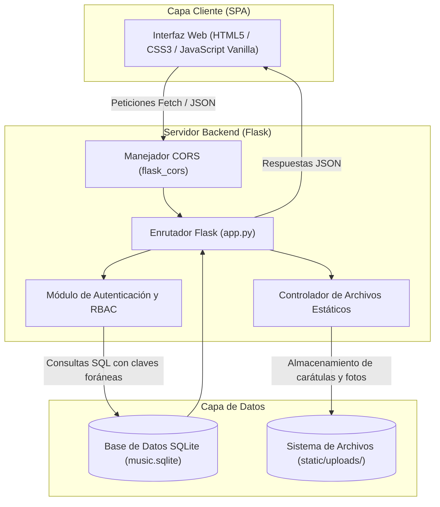
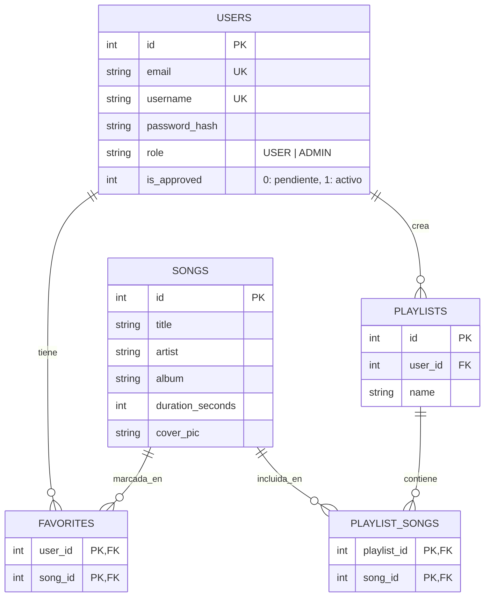

<p align="center">
  
</p>

# Plataforma Web de Gestión y Streaming Musical

<p align="left">
  
  
  
  
  
  
</p>

Aplicación web desarrollada como Single Page Application (SPA) para la gestión, catalogación y streaming de audio. El backend está implementado en Python con Flask mediante una arquitectura de API REST desacoplada, utilizando persistencia sobre SQLite3 y almacenamiento local para recursos multimedia.

Proyecto desarrollado para la asignatura Gestión de Proyectos (GP) por el grupo Lion Crusaders.

---

## Índice
- [Descripción general](#descripción-general)
- [Arquitectura del sistema](#arquitectura-del-sistema)
- [Modelo de datos](#modelo-de-datos)
- [Especificación de la API REST](#especificación-de-la-api-rest)
- [Estructura del proyecto](#estructura-del-proyecto)
- [Instalación y puesta en marcha](#instalación-y-puesta-en-marcha)
- [Equipo](#equipo)
- [Contexto académico](#contexto-académico)

---

## Descripción general

La aplicación permite la interacción de dos perfiles de usuario diferenciados (usuarios finales y administradores) mediante una interfaz dinámica que consume servicios REST internos.

Aspectos técnicos destacados:
- Arquitectura desacoplada: interfaz cliente orientada a SPA que interactúa con el servidor exclusivamente a través de llamadas asíncronas a la API REST.
- Seguridad y autenticación: almacenamiento de credenciales mediante hashes criptográficos (`generate_password_hash` con scrypt) y validación de sesiones.
- Control de acceso basado en roles (RBAC):
  - Usuario: exploración de catálogo, reproducción, creación de listas de reproducción personalizadas y marcado de favoritos.
  - Administrador: moderación de altas de usuario mediante flujo de aprobación (`is_approved`), carga y mantenimiento del catálogo de canciones y gestión de portadas.
- Almacenamiento y tratamiento de ficheros: gestión de subida de imágenes de perfil (`/static/uploads/profiles`) y portadas de canciones (`/static/uploads/covers`) con validación de extensiones y nombres seguros (`secure_filename`).

---

## Arquitectura del sistema



---

## Modelo de datos

El esquema relacional implementado en `database/schema.sql` asegura integridad referencial mediante claves foráneas y operaciones de borrado en cascada:



---

## Especificación de la API REST

### Autenticación y Perfil
| Método | Endpoint | Descripción |
| :--- | :--- | :--- |
| `POST` | `/api/register` | Registro de nuevos usuarios (estado pendiente por defecto) |
| `POST` | `/api/login` | Validación de credenciales y comprobación de estado de cuenta |
| `GET` | `/api/profile/<user_id>` | Consulta de información de perfil de usuario |
| `PUT` | `/api/profile/<user_id>` | Actualización de datos de usuario |
| `POST` | `/api/profile/<user_id>/upload-pic` | Carga de imagen de perfil |

### Catálogo de Canciones
| Método | Endpoint | Descripción |
| :--- | :--- | :--- |
| `GET` | `/api/songs` | Listado completo de canciones disponibles |
| `POST` | `/api/songs` | Alta de nueva canción con metadatos y portada (Admin) |
| `GET` | `/api/songs/<song_id>` | Consulta de detalle de una canción |
| `PUT` | `/api/songs/<song_id>` | Edición de metadatos de una canción (Admin) |
| `DELETE` | `/api/songs/<song_id>` | Eliminación de canción del catálogo (Admin) |

### Listas de Reproducción y Favoritos
| Método | Endpoint | Descripción |
| :--- | :--- | :--- |
| `GET` | `/api/playlists/<user_id>` | Listas creadas por un usuario |
| `POST` | `/api/playlists/<user_id>` | Creación de nueva lista de reproducción |
| `DELETE` | `/api/playlists/<playlist_id>` | Eliminación de lista de reproducción |
| `GET` | `/api/playlists/<playlist_id>/songs` | Canciones contenidas en una lista |
| `POST` | `/api/playlists/<playlist_id>/songs` | Añadir canción a una lista |
| `DELETE` | `/api/playlists/<playlist_id>/songs/<song_id>` | Quitar canción de una lista |
| `GET` | `/api/favorites/<user_id>` | Listado de canciones favoritas del usuario |
| `POST` | `/api/favorites/<user_id>` | Marcar canción como favorita |
| `DELETE` | `/api/favorites/<user_id>/<song_id>` | Desmarcar canción de favoritos |

### Panel de Administración
| Método | Endpoint | Descripción |
| :--- | :--- | :--- |
| `GET` | `/api/admin/pending_users` | Listado de usuarios pendientes de activación |
| `POST` | `/api/admin/approve/<user_id>` | Aprobación de acceso para un usuario |
| `DELETE` | `/api/admin/reject/<user_id>` | Rechazo y eliminación de solicitud de registro |

---

## Estructura del proyecto

```text
GP-Lion-Crusaders/
├── database/
│   ├── music.sqlite            # Base de datos relacional (generada localmente)
│   └── schema.sql              # Definición DDL del esquema y usuario administrador inicial
├── static/
│   ├── uploads/
│   │   ├── covers/             # Almacenamiento de carátulas de canciones
│   │   └── profiles/           # Almacenamiento de imágenes de perfil
│   ├── leon-removebg-preview.png
│   └── [iconos e imágenes de interfaz]
├── templates/
│   └── index.html              # Interfaz de usuario Single Page Application (SPA)
├── app.py                      # Servidor web y endpoints de la API REST
├── requirements.txt            # Dependencias del entorno Python
└── README.md
```

---

## Instalación y puesta en marcha

### Requisitos previos
- Python 3.10 o superior.

### 1. Clonar el repositorio
```bash
git clone https://github.com/28ivan/music-streaming-flask.git
cd music-streaming-flask
```

### 2. Configurar entorno virtual
En Windows (PowerShell):
```powershell
python -m venv venv
.\venv\Scripts\Activate.ps1
```

En Linux / macOS:
```bash
python3 -m venv venv
source venv/bin/activate
```

### 3. Instalar dependencias
```bash
pip install -r requirements.txt
```

### 4. Inicializar la base de datos
Para crear el archivo de base de datos a partir del esquema DDL:
```bash
python -c "import sqlite3; conn = sqlite3.connect('database/music.sqlite'); conn.executescript(open('database/schema.sql', encoding='utf-8').read()); conn.close()"
```

### 5. Iniciar la aplicación
```bash
python app.py
```
Abrir el navegador en `http://localhost:5000`.

---

## Equipo

Proyecto desarrollado de forma colaborativa por:
- **[Iván Herrera Álvarez](https://github.com/28ivan)**
- Iker Ciordia Elorriaga
- Laura Calvo Posada
- Ziyan Jiang
- Emiliano Fernández Reyes
- Alexander Díez Ortuzar

---

## Contexto académico

Proyecto desarrollado para la asignatura de **Gestión de Proyectos (GP)** en el **Grado en Ingeniería Informática de Gestión y Sistemas de Información** de la **Universidad del País Vasco (UPV/EHU)**.
